<p align="center">
  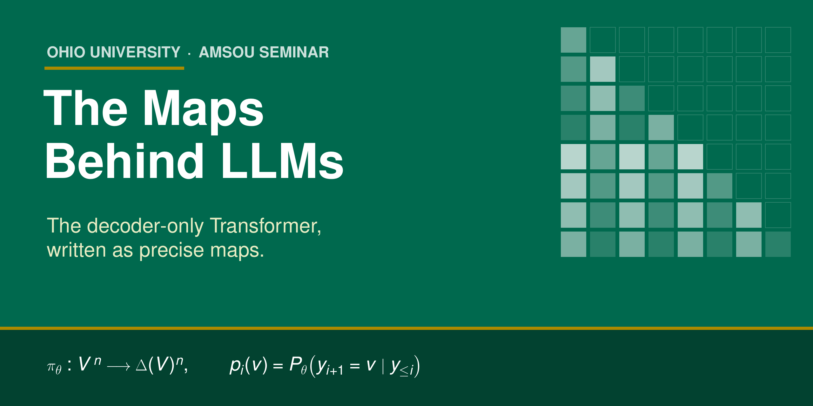
</p>

<p align="center">
  
  
  
  
</p>

<h3 align="center"><em>Every word an AI writes is the output of one math function.<br>This talk writes that function down, map by map.</em></h3>

<p align="center">
  <a href="slides/decoder_transformer_seminar.pdf"><b>📘 Full deck (40 slides, PDF)</b></a>
  &nbsp;·&nbsp;
  <a href="linkedin/carousel.pdf"><b>📱 7-slide visual summary</b></a>
  &nbsp;·&nbsp;
  <a href="slides/decoder_transformer_seminar.tex"><b>🧾 LaTeX source</b></a>
</p>

---

## 🎯 The idea in one line

A decoder-only language model is a single map from a sequence of tokens to a sequence of probability distributions:

```math
\pi_\theta : \mathcal V^{\,n} \longrightarrow \Delta(\mathcal V)^{n},
\qquad
p_i(v) \;=\; P_\theta\big(y_{i+1}=v \,\big|\, y_{\le i}\big).
```

Every slide in the deck builds one piece of that map, with domain, codomain, and dimensions stated explicitly. The whole thing assembles into one chain:

```math
\mathcal V^{\,n}
\xrightarrow{\ \mathrm{Emb}\ } \mathbb R^{n\times d}
\xrightarrow{\ \mathrm{DL}_L\circ\cdots\circ\mathrm{DL}_1\ } \mathbb R^{n\times d}
\xrightarrow{\ \mathrm{LN}_f,\ W_{\mathrm{vocab}},\ b\ } \mathbb R^{n\times|\mathcal V|}
\xrightarrow{\ \mathrm{softmax}_{\mathrm{row}}\ } \Delta(\mathcal V)^{n},
\qquad
\mathrm{DL}_\ell=\mathrm{FFN.B}_\ell\circ\mathrm{Attn.B}_\ell .
```

---

## 🧱 The architecture at a glance

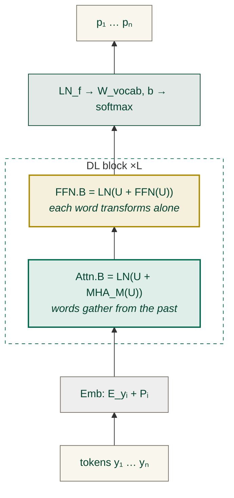

---

## 👀 Two layers on every page: *in words* and *in maps*

The talk was built for a room of **graduate students and faculty** with very different backgrounds, so each idea is shown twice: once as a picture anyone can follow, once as the exact map.

<table>
  <tr>
    <td align="center" width="33%">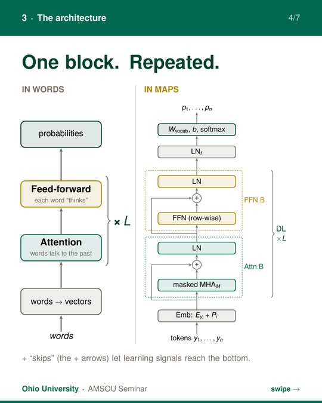<br><b>The architecture</b><br><sub>plain stack ↔ Emb, MHA<sub>M</sub>, ⊕, LN, FFN</sub></td>
    <td align="center" width="33%">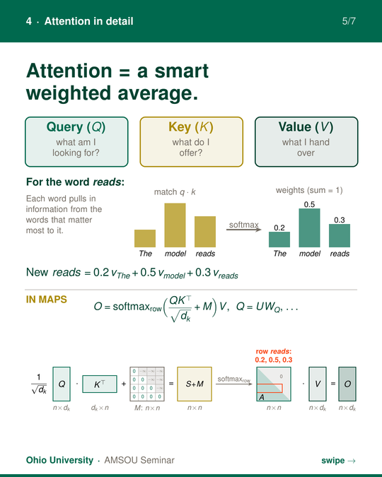<br><b>Attention</b><br><sub>a weighted average ↔ softmax(QKᵀ/√d<sub>k</sub> + M)V</sub></td>
    <td align="center" width="33%">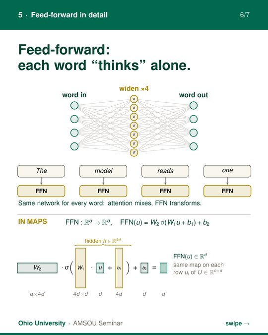<br><b>Feed-forward</b><br><sub>“each word thinks” ↔ W₂σ(W₁u + b₁) + b₂</sub></td>
  </tr>
</table>

| Idea | In words | In maps |
|---|---|---|
| **Attention** | each word gathers information from the words before it | $o_i=\sum_{j\le i} a_{ij}\,v_j,\quad a_{i\cdot}=\mathrm{softmax}\big(q_i^\top k_\cdot/\sqrt{d_k}+M_{i\cdot}\big)$ |
| **Masking** | no peeking at the future | $M_{ij}=0$ for $j\le i$, $\ M_{ij}=-\infty$ for $j>i$ |
| **Feed-forward** | each word is transformed on its own | $\mathrm{FFN}:\mathbb R^d\to\mathbb R^d$, applied row-wise to $U\in\mathbb R^{n\times d}$ |
| **Skips** | learning signals reach the bottom | $\mathrm{Attn.B}(U)=\mathrm{LN}\big(U+\mathrm{MHA}_M(U)\big)$ |
| **Training** | get less surprised by the true next word | $L_i=-\log p_i(y_{i+1}),\quad \partial L_i/\partial z_i = p_i-e_{y_{i+1}}$ |

---

## 📱 The 7-slide visual summary

<p align="center">
  <a href="linkedin/carousel.pdf">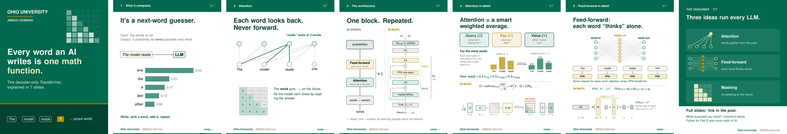</a>
</p>

---

## 🔍 Inside the full deck

<table>
  <tr>
    <td width="50%">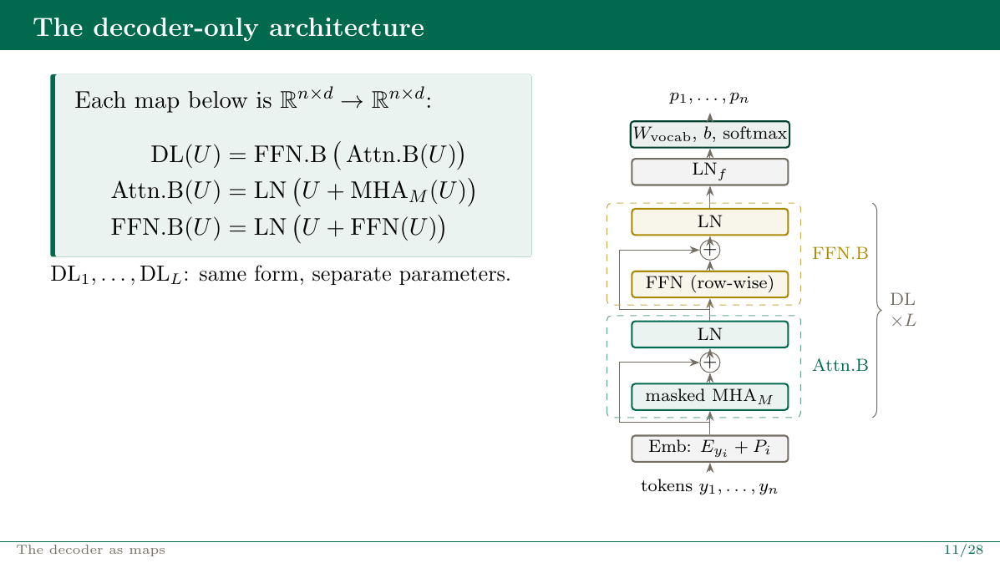<br><sub><b>Slide 11.</b> The decoder-only architecture as a composition of maps</sub></td>
    <td width="50%">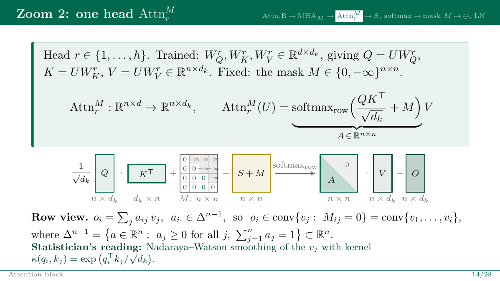<br><sub><b>Slide 14.</b> One attention head, with every shape stated</sub></td>
  </tr>
  <tr>
    <td>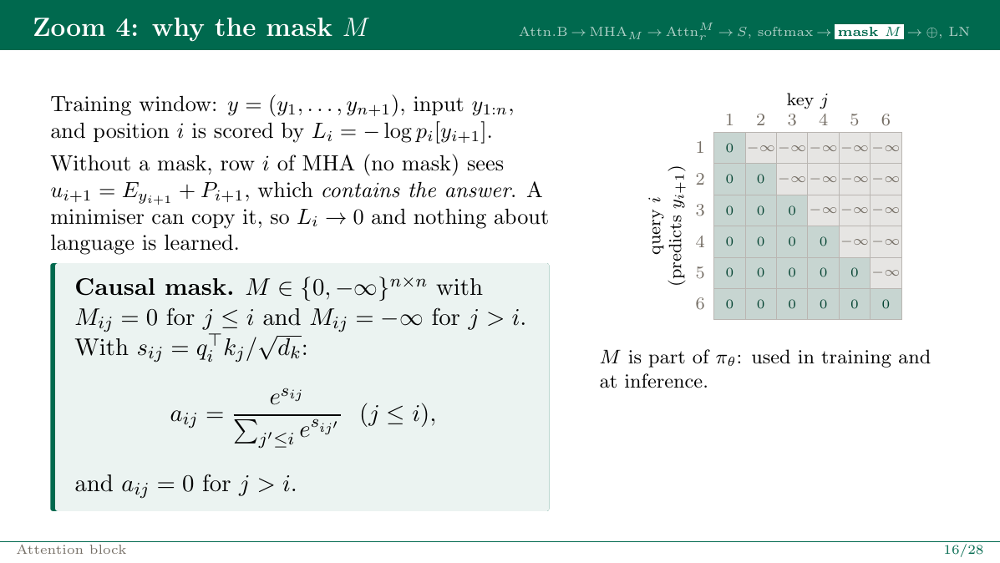<br><sub><b>Slide 16.</b> Why the mask: the model cannot read the answer</sub></td>
    <td>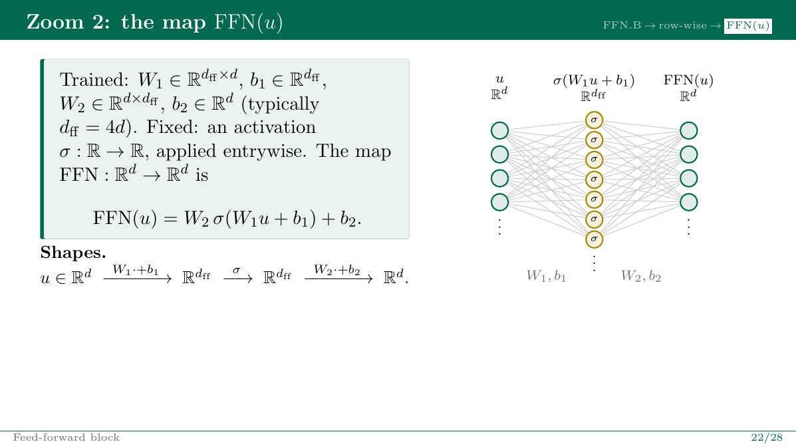<br><sub><b>Slide 22.</b> The feed-forward map and its parameter shapes</sub></td>
  </tr>
  <tr>
    <td>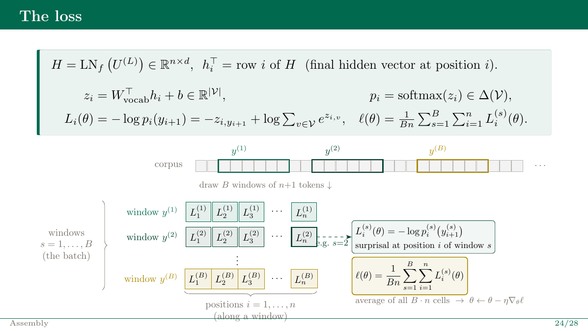<br><sub><b>Slide 29.</b> The loss: cross-entropy over every position at once</sub></td>
    <td>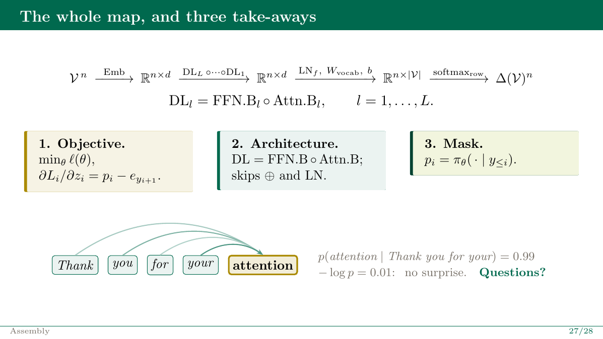<br><sub><b>Slide 39.</b> The whole map, and three take-aways</sub></td>
  </tr>
</table>

### Roadmap of the talk

| Part | Slides | What it covers |
|---|---|---|
| **I. Where it came from** | 4–9 | Shannon’s entropy of English (1948/51) · Rosenblatt’s perceptron (1958) · XOR and Minsky–Papert (1969) · hidden layers · expressivity vs. trainability |
| **II. The maps** | 10–22 | Embedding $\mathrm{Emb}$ · $\mathrm{Attn.B}$ and multi-head attention · the causal mask · residuals and LayerNorm · $\mathrm{FFN.B}$ and universal approximation |
| **III. Learning** | 23–36 | A “how surprised are you?” game · the loss $L_i=-\log p_i(y_{i+1})$ · its gradient $p_i-e_{y_{i+1}}$ · gradient descent and teacher forcing |
| **Wrap-up** | 37–40 | The whole map · three take-aways · references |

> **Status:** Part 1 (slides 1–18) has been presented. **Part 2** (slides 19–40, from residuals and FFN through the loss and training) is coming next. ⭐ Star or watch the repo to get it when it lands.

---

## 🗂️ Repository layout

```
maps-behind-llms/
├── README.md
├── slides/
│   ├── decoder_transformer_seminar.pdf    full 40-slide deck
│   └── decoder_transformer_seminar.tex    Beamer source (self-contained)
├── linkedin/
│   ├── carousel.pdf                       7-page visual summary (1080×1350)
│   └── carousel.tex                       TikZ source
├── figures/                               images used in this README
└── LICENSE
```

## 🛠️ Build from source

Both files are self-contained (no external images), using only standard TeX Live packages.

```bash
cd slides   && pdflatex decoder_transformer_seminar.tex && pdflatex decoder_transformer_seminar.tex
cd ../linkedin && pdflatex carousel.tex
```

## 📚 References

- C. E. Shannon (1948). *A mathematical theory of communication.* Bell System Technical Journal 27. See also Shannon (1951), *Prediction and entropy of printed English.*
- F. Rosenblatt (1958). *The perceptron: a probabilistic model for information storage and organization in the brain.* Psychological Review 65.
- G. Cybenko (1989). *Approximation by superpositions of a sigmoidal function.* Mathematics of Control, Signals and Systems 2.
- M. Leshno, V. Lin, A. Pinkus, S. Schocken (1993). *Multilayer feedforward networks with a nonpolynomial activation function can approximate any function.* Neural Networks 6.
- A. Vaswani et al. (2017). *Attention is all you need.* NeurIPS.
- A. Radford, K. Narasimhan, T. Salimans, I. Sutskever (2018). *Improving language understanding by generative pre-training.* OpenAI.

---

<p align="center">
  Presented at the <b>American Mathematical Society Chapter at Ohio University (AMSOU)</b><br>
  Department of Mathematics · Ohio University<br>
  <sub>by <b>Alfred Adzika</b> · <a href="https://www.linkedin.com/in/alfred-adzika/">LinkedIn</a></sub>
</p>

<p align="center"><sub>Slides and figures © the author, shared under <a href="LICENSE">CC BY 4.0</a>. You may reuse them with attribution.</sub></p>
